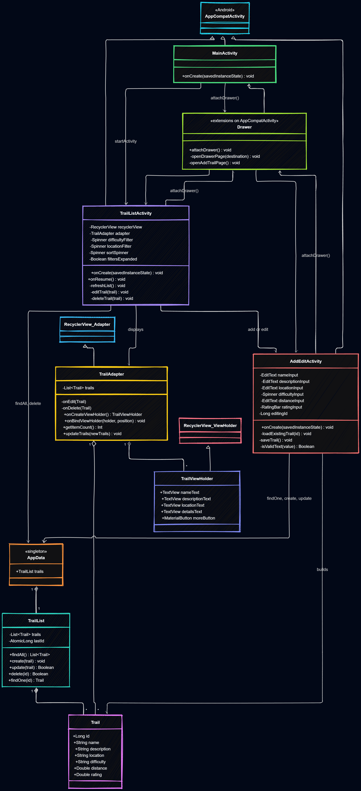

# HikingHub

Android app for browsing and managing hiking trails. Continuous assesment for the Mobile App Development module.

## Features

- **Home**: starting screen with a link to the trail list
- **Navigation drawer**: Home, trail list, and add a trail
- **Trail list**: name, description, location, difficulty, distance (km), and rating
- **Add and edit**: form with input checks for name, description, location, and distance
- **Delete**: remove a trail from the list
- **Filters**: difficulty (Easy, Moderate, Strenuous) and location, in a collapsible panel
- **Sort**: by distance or rating, shortest/longest and highest/lowest

Sample Irish walking trails are included using API. Trail data is held in memory for the current session.

## UML diagram

