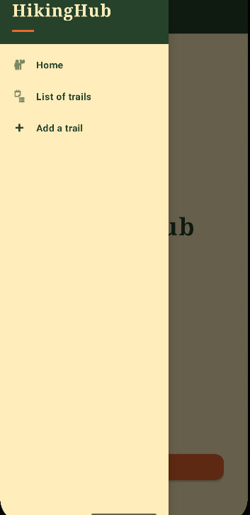
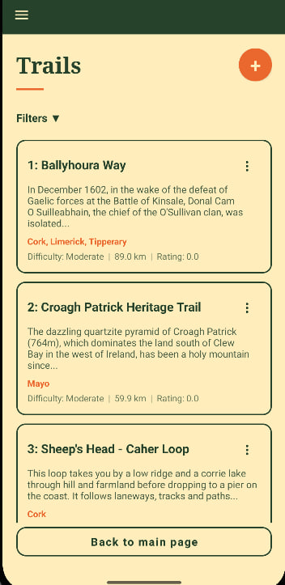
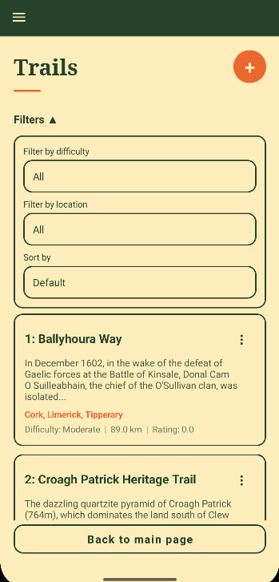
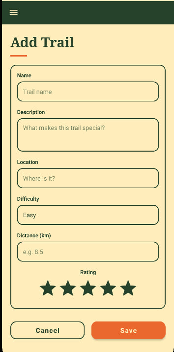

# HikingHub

Android app for browsing and managing hiking trails. Continuous assesment for the Mobile App Development module.

## Functionality

HikingHub lets a user browse Irish walking trails and manage the list during the current session. From the home screen or the navigation drawer, the user opens the trail list, which shows each trail’s name, description, location, difficulty, distance, and rating. Trails can be added, edited, or deleted. The add and edit form checks that the name, description, location, and distance are valid before saving. The list can be filtered by difficulty (Easy, Moderate, Strenuous) and location, and sorted by distance or rating. Sample trails are loaded from an API and kept in memory for the session only.

## Features

- **Home**: starting screen with a link to the trail list
- **Navigation drawer**: Home, trail list, and add a trail
- **Trail list**: name, description, location, difficulty, distance (km), and rating
- **Add and edit**: form with input checks for name, description, location, and distance
- **Delete**: remove a trail from the list
- **Filters**: difficulty (Easy, Moderate, Strenuous) and location, in a collapsible panel
- **Sort**: by distance or rating, shortest/longest and highest/lowest

Sample Irish walking trails are included using API. Trail data is held in memory for the current session.

## Screenshots

**Home**

**Navigation drawer**

**Trail list**

**Filters**

**Add a trail**

## UML diagram

